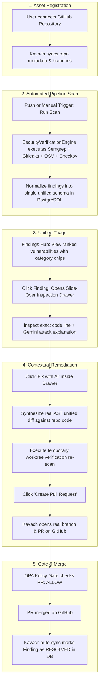
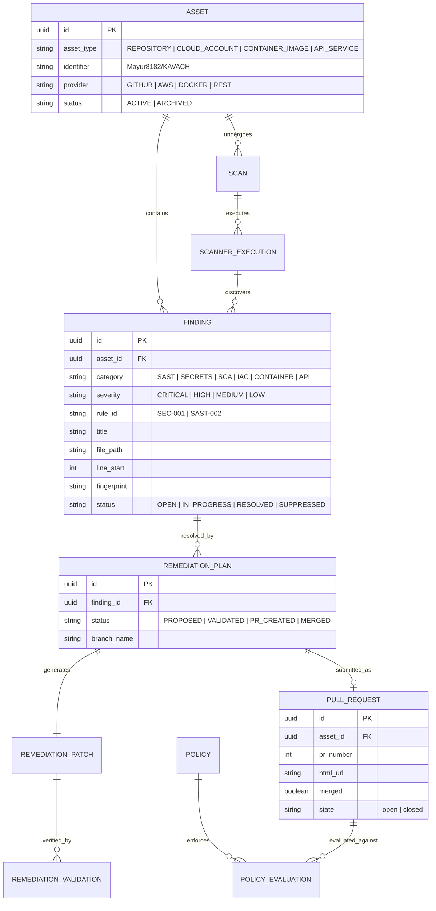

# KAVACH — PROPOSED PRODUCT & WORKFLOW ARCHITECTURE

**Report ID:** KAV-AUDIT-07  
**Author:** Principal Product Architect & Application Security Architect  
**Date:** November 2026  
**Status:** COMPLETE & PROPOSED FOR IMPLEMENTATION  
**Primary Conceptual Reference:** Aikido Security (with Snyk, Wiz, and Semgrep best practices)  

---

## 1. Competitive Architecture Benchmark: Aikido Security

Aikido Security transformed modern Application Security by rejecting the legacy model of "selling 10 different dashboards for 10 different scanners". In traditional legacy platforms (e.g. Checkmarx, legacy Snyk, Micro Focus), each security domain is treated as a separate silo with its own menus, scans, and reports.

Aikido's core architectural thesis is:
> **"Everything to protect is an Asset. Everything detected is an Issue. Triage in one feed. Remediate with 1-click PRs. Gate at the PR."**

```
AIKIDO SECURITY REFERENCE WORKFLOW:
┌────────────────┐      ┌─────────────────────────┐      ┌────────────────────────┐      ┌─────────────────────────┐
│     ASSET      │ ───► │      UNIFIED SCAN       │ ───► │      FINDING FEED      │ ───► │       AUTOFIX PR        │
│ (Repo/Cloud)   │      │ (SAST/SCA/Secret/IaC)   │      │ (Normalized & Ranked)  │      │ (Branch + Verified PR)  │
└────────────────┘      └─────────────────────────┘      └────────────────────────┘      └─────────────────────────┘
```

### Key Architectural Lessons for Kavach
1. **Scanners are Engines, NOT Products:** SAST, Secrets, SCA, IaC, and Container security should never have their own top-level sidebar menus. They are background detection services that feed findings into a single, unified database.
2. **Unified Vulnerability Management:** There should be exactly **one** Findings page. An engineer should never have to visit a separate page for SAST findings vs Secret findings vs Dependency CVEs. They are simply filter chips on the main findings table.
3. **In-Place Remediation:** Autofix should not be a separate 1,830-line destination page. It is a **contextual action** triggered directly inside the finding slide-over drawer:
   `Click Finding Drawer → Inspect Vulnerable Code → Click "Fix with AI" → Review In-Place Diff → Click "Create PR"`.
4. **Permanent, Immutable Navigation:** The sidebar must remain identical on every screen. Navigating into a finding, a scan, or a repository should never change the sidebar items.

---

## 2. Current vs. Proposed Information Architecture

### 2.1 Current Information Architecture Tree (Fragmented, 15 Mutually Exclusive Modes)
```
CURRENT KAVACH ARCHITECTURE (539 Pages / 15 Sub-Suites)
├── [Mode 1: Core]
│   ├── Overview (/overview -> code/page)
│   ├── Home (/home)
│   ├── Assistant (/assistant)
│   ├── Runs (/runs)
│   ├── Findings (/findings)
│   ├── Fixes (/fixes)
│   ├── Repositories (/repositories)
│   └── Reports (/reports)
├── [Mode 2: Code Security]
│   ├── Overview (/code)
│   ├── Local Audit (/code/local-audit)
│   ├── Jobs (/code/jobs - 5,500 lines)
│   ├── Autofix (/code/autofix - 1,830 lines)
│   ├── Evidence (/code/evidence)
│   └── Pull Requests (/code/pull-requests)
├── [Mode 3: SAST Analysis Engine - 9 Pages]
│   └── Overview, Agent, Findings, Hotspots, Scans, Rules, Remediation, Reports, Settings
├── [Mode 4: Dependencies & SCA Engine - 78 Pages]
│   └── Overview, Inventory, Vulnerabilities, Versions, Ecosystems, Graph, Licenses, Health, Remediation, SBOM, Policies, Scans, Reports, Settings
├── [Mode 5: IaC Security - 24 Pages]
│   └── Overview, Repositories, Inventory, Findings, Graph, AI, Remediation, Plans, Scans, Policies, Compliance, Integrations, Reports, Settings
├── [Mode 6: Container Security - 48 Pages]
│   └── Overview, Inventory, Images, Dockerfiles, Findings, Secrets, SBOM, Registries, Workloads, Runtime, Scans, CI/CD, AI, Remediation, Policies
├── [Mode 7: API Security - 20 Pages]
│   └── Overview, Discovery, APIs, Analysis, Findings, Attack Paths, Analyst, Reports, Integrations, Policies, Settings
├── [Mode 8: Cloud Security - 22 Pages]
│   └── Overview, Connections, Assets, Findings, IAM, Network, Storage, Database, Kubernetes, Docker, IaC, Exposures, Attack Paths, Compliance, Remediation
├── [Mode 9: SOC & Triage - 15 Pages]
├── [Mode 10: Nexora QA - 15 Pages]
├── [Mode 11: Sales & Enterprise - 15 Pages]
└── [Mode 12: Superadmin - 52 Pages]
```

---

### 2.2 Proposed Information Architecture Tree (Clean, 7-Item Permanent Navigation)

```
PROPOSED KAVACH WORKFLOW-DRIVEN ARCHITECTURE (Locked Permanent Sidebar)
│
├── 1. Security HQ                  (/overview)
│   ├── Triage Feed (Critical attention items needing action)
│   ├── Security Score & Coverage Meter (Repositories, Cloud, APIs)
│   ├── Recent Scanner Pipeline Activity (Live running jobs)
│   └── Quick Action Command Bar (Run scan, connect repo, invite member)
│
├── 2. Assets                       (/assets)
│   ├── [Tab] Repositories          (/assets/repositories)      ── GitHub, GitLab, Bitbucket codebases
│   ├── [Tab] Cloud Accounts        (/assets/cloud)             ── AWS IAM, GCP, Azure accounts (Real only)
│   ├── [Tab] Container Registries  (/assets/containers)        ── ECR, Docker Hub, GCR images
│   ├── [Tab] APIs & Services       (/assets/apis)              ── Discovered OpenAPI / REST endpoints
│   └── [Tab] Packages & SBOM       (/assets/packages)          ── Dependencies, licenses, CycloneDX SBOM
│
├── 3. Findings                     (/findings)
│   ├── Universal Filter Bar:
│   │   ├── Category Chips: [All] [Code / SAST] [Secrets] [Dependencies / SCA] [IaC] [Containers] [API]
│   │   ├── Severity Chips: [Critical] [High] [Medium] [Low]
│   │   ├── Status Chips:   [Open] [In Progress] [Ignored / False Positive] [Resolved]
│   │   └── Asset Filter:   [Select Repository / Cloud Asset]
│   ├── Finding List Table (Paginated, sortable, multi-select batch actions)
│   ├── [Sub-Tab] Hotspots Queue    (/findings/hotspots)        ── Manual human security review queue
│   └── [Slide-Over Drawer] Finding Detail & Remediation Studio
│       ├── Vulnerable Code Snippet & AST Taint Path
│       ├── Attack Scenario & Exploit Impact (Gemini grounded explanation)
│       ├── In-Place Code Diff Editor (Proposed patch preview)
│       └── 1-Click Action Buttons: [Validate & Rescan] [Create Pull Request] [Ignore / Mute]
│
├── 4. Fixes & Pull Requests        (/fixes)
│   ├── [Tab] Pull Requests         (/fixes/pull-requests)      ── Active automated PRs, CI pass/fail, merge sync
│   └── [Tab] Fix Proposals         (/fixes/proposals)          ── Queue of AI-generated patches ready for review
│
├── 5. Security Runs & Pipelines    (/runs)
│   ├── [Tab] Execution Runs        (/runs)                     ── Real-time timeline of multi-scanner runs
│   ├── [Tab] Scheduled Scans       (/runs/schedules)           ── Recurring daily/weekly automated scans
│   ├── [Tab] CI/CD Gates           (/runs/gates)               ── GitHub Actions PR checks & status evaluations
│   └── [Detail View] Run Telemetry (/runs/[runId])             ── Streaming step tracker & stdout/stderr logs
│
├── 6. Policies & Governance        (/policies)
│   ├── [Tab] Quality Gates (OPA)   (/policies/gates)           ── Rego PR blocking rules & threshold policies
│   ├── [Tab] Security Rules        (/policies/rules)           ── Enabled Semgrep, Gitleaks, Checkov rules
│   ├── [Tab] Compliance Frameworks (/policies/compliance)      ── SOC2, ISO27001, CIS, HIPAA control mapping
│   └── [Tab] Reports & Evidence    (/policies/reports)         ── Audit-ready PDF/CSV/JSON exports & SBOM
│
├── 7. Settings & Integrations      (/settings)
│   ├── [Tab] Integrations          (/settings/integrations)    ── GitHub, Slack, Jira, AWS, Datadog
│   ├── [Tab] Workspace & Team      (/settings/team)            ── Members, RBAC roles, invitations
│   ├── [Tab] API Keys & Tokens     (/settings/api-keys)        ── Personal tokens & machine CLI credentials
│   ├── [Tab] Audit Logs            (/settings/audit-logs)      ── Immutable security audit trail
│   └── [Tab] Billing & Quotas      (/settings/billing)         ── Subscription tier, seat quotas, invoices
│
└── [Global Overlay] AI Copilot Drawer (Accessible via ⌘K or Floating Action Button)
    └── Contextual slide-over assistant with real project context on any screen
```

---

## 3. Current-to-Proposed Page Mapping Matrix

The following table maps all major existing pages into their consolidated proposed locations:

| Current Route | Current Page Name | Proposed Consolidated Location | Navigation Mechanism |
|---|---|---|---|
| `/home` | Security HQ | `/overview` | Merged into Security HQ hero |
| `/code` | Code Overview | `/overview` | Merged into Security HQ |
| `/dashboard` | Dashboard Redirect | `/overview` | Permanent 301 Redirect |
| `/repositories` | Repositories Hub | `/assets/repositories` | Tab under Assets |
| `/code/repositories` | Legacy Code Repos | `/assets/repositories` | Permanent 301 Redirect |
| `/api-security/discovery` | API Discovery | `/assets/apis` | Tab under Assets |
| `/code/iac/repositories` | IaC Repositories | `/assets/repositories` | Filter chip on Assets |
| `/container-security/images` | Container Images | `/assets/containers` | Tab under Assets |
| `/code/dependencies/inventory` | Package Inventory | `/assets/packages` | Tab under Assets |
| `/code/dependencies/versions` | Package Versions | `/assets/packages` | Sub-view under Packages |
| `/code/dependencies/graph` | Dependency Graph | `/assets/packages` | Drawer/modal on package click |
| `/code/sbom` | SBOM Hub | `/policies/reports` (SBOM Tab) | Tab under Policies/Reports |
| `/findings` | Unified Findings | `/findings` | Authoritative Findings Hub |
| `/code/findings` | Legacy Findings | `/findings` | Permanent 301 Redirect |
| `/code/sast/findings` | SAST Findings | `/findings?category=SAST` | Category filter chip |
| `/code/secrets` | Secrets Findings | `/findings?category=SECRETS` | Category filter chip |
| `/code/dependencies/vulnerabilities` | Dependency Vulnerabilities | `/findings?category=SCA` | Category filter chip |
| `/code/iac/findings` | IaC Findings | `/findings?category=IAC` | Category filter chip |
| `/container-security/findings` | Container Findings | `/findings?category=CONTAINER`| Category filter chip |
| `/api-security/findings` | API Findings | `/findings?category=API` | Category filter chip |
| `/code/sast/hotspots` | Security Hotspots | `/findings/hotspots` | Sub-tab on Findings |
| `/fixes` | Fixes Hub | `/fixes` | Primary Fixes destination |
| `/code/autofix` | Autofix Studio | `/fixes/proposals` | Tab under Fixes |
| `/code/pull-requests` | Pull Requests Hub | `/fixes/pull-requests` | Tab under Fixes |
| `/code/dependencies/remediation` | Dependency Remediation | `/fixes?category=SCA` | Category filter on Fixes |
| `/code/iac/remediation` | IaC Remediation | `/fixes?category=IAC` | Category filter on Fixes |
| `/runs` | Security Runs Hub | `/runs` | Authoritative Runs destination |
| `/scans` | Legacy Scans | `/runs` | Permanent 301 Redirect |
| `/code/jobs` | Security Jobs (5,500L) | `/runs` | Consolidated into `/runs` |
| `/code/sast/scans` | SAST Scans | `/runs?engine=semgrep` | Engine filter on Runs |
| `/code/dependencies/scans` | Dependency Scans | `/runs?engine=osv` | Engine filter on Runs |
| `/code/iac/scans` | IaC Scans | `/runs?engine=checkov` | Engine filter on Runs |
| `/container-security/scans` | Container Scans | `/runs?engine=trivy` | Engine filter on Runs |
| `/ci-cd` | CI/CD Pipelines | `/runs/gates` | Tab under Runs |
| `/policies` | Policies Hub | `/policies/gates` | Tab under Policies |
| `/code/policies` | Duplicate Policies | `/policies/gates` | Permanent 301 Redirect |
| `/code/sast/rules` | SAST Rules | `/policies/rules` | Tab under Policies |
| `/code/dependencies/policies` | Dependency Policies | `/policies/gates?domain=deps` | Filter on Policies |
| `/governance` | Governance & Frameworks | `/policies/compliance` | Tab under Policies |
| `/reports` | Reports Hub | `/policies/reports` | Tab under Policies |
| `/code/evidence` | Evidence Store | `/policies/reports` | Tab under Policies |
| `/integrations` | Integrations Hub | `/settings/integrations` | Tab under Settings |
| `/settings/integrations` | Duplicate Integrations | `/settings/integrations` | Consolidated |
| `/audit-logs` | Audit Logs | `/settings/audit-logs` | Tab under Settings |
| `/assistant` | AI Assistant | Contextual Copilot Drawer + `/assistant` | Global Slide-Over Panel |
| `/agent/*` (22 pages) | Agent Guard Suite | `/specialized/agent-guard` | Moved to Specialized drawer |
| `/cloud/*` (22 pages) | Cloud Posture Suite | `/assets/cloud` (Real only) | Hidden until real cloud scan works |
| `/soc/*` (15 pages) | SOC Suite | `/specialized/soc` | Moved to Specialized drawer |
| `/qa/*` (15 pages) | Nexora QA | Deferred / Separate product | Hidden from main AppSec nav |
| `/sales/*` (15 pages) | Sales & POC Suite | Direct sales URL only | Removed from product sidebar |
| `/superadmin/*` (52 pages) | Superadmin Suite | Topbar role switcher | Only visible to `is_superuser=True` |

---

## 4. End-to-End User Journey: The Ideal DevSecOps Flow



---

## 5. Core Entity Relationship Model

To support this unified architecture without data silos, the database schema should converge around four core entities:



---

## 6. Scope Boundaries: MVP Scope vs. Deferred Features

### 6.1 Recommended MVP Scope (The Core DevSecOps Platform)
1. **Permanent 7-Item Navigation:** Lock `Sidebar.tsx`, eliminate all route-morphing.
2. **Unified Security HQ (`/overview`):** Single entry point with triage feed and active scan status.
3. **Consolidated Assets Hub (`/assets`):** Repositories, packages, and container images in one tabbed view.
4. **Single Findings Feed (`/findings`):** All vulnerability types in one paginated, searchable, filterable table.
5. **In-Place Drawer Remediation:** Generate diffs, validate, and create GitHub PRs directly from the finding slide-over drawer.
6. **Unified Security Runs (`/runs`):** Real-time execution logs for all scanners; delete duplicate `code/jobs` (5,500L).
7. **Policies & OPA Quality Gates (`/policies`):** Rego rules, PR blocking thresholds, and compliance reports.
8. **Real LLM AST Patch Synthesis:** Fix `_generate_deterministic_patch` to use real file lines and Google Gemini.
9. **Real Re-scan in Validation:** Ensure `/validate` executes a real verification scan instead of hardcoding "PASSED".
10. **Deactivate Fake Cloud Seeding:** Clean up `ensure_baseline_cloud_data_seeded()`; show honest `NOT CONNECTED` states.

### 6.2 Deferred Features (To Preserve Product Focus)
1. **Nexora QA (`/qa/*` — 15 pages):** Defer completely. QA test management dilutes the cybersecurity focus.
2. **Sales & POC Funnel (`/sales/*` — 15 pages):** Remove from the authenticated product sidebar. Move to external marketing routes.
3. **SOC & Triage (`/soc/*` — 15 pages):** Move to expandable "Specialized Defense" drawer; focus 100% on DevSecOps developer workflows first.
4. **Autonomous Agent Guard (`/agent/*` — 22 pages):** Retain under "Specialized Defense" drawer as an advanced feature for AI security specialists.
5. **Attack Surface DAST (`/attack/*` — 21 pages):** Keep in background until DAST worker pipeline is fully production-verified.

