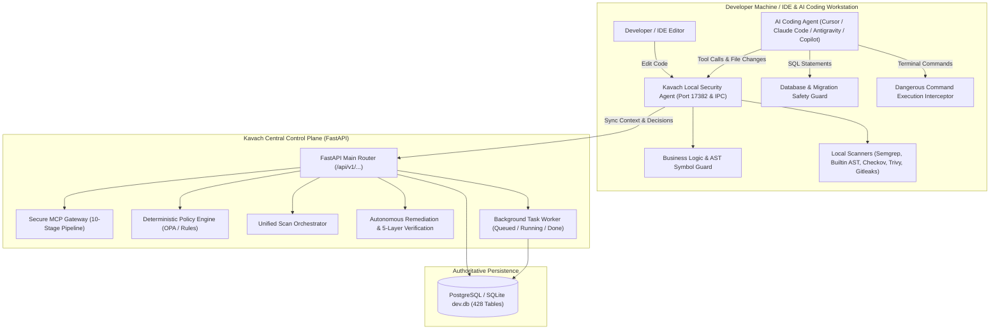
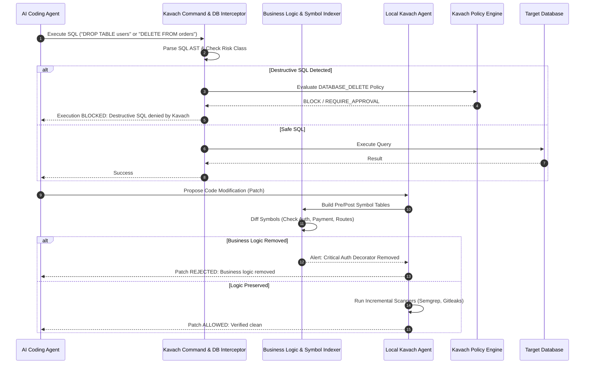

# KAVACH — COMPLETE CODE SECURITY, AI CODING AGENT & LOCAL SECURITY ENGINE AUDIT

**Audit Date:** November 9, 2026  
**Auditors:** Principal Application Security Architect, Staff Software Engineer, DevSecOps Architect, AI Agent Systems Engineer, Database Reliability Engineer  
**Target:** Kavach (formerly Thing / SecuLayer) Application Security & DevSecOps Platform  
**Operational Invariant:** *"LLM proposes. Deterministic security systems decide. Runtime evidence proves."*

---

# EXECUTIVE SUMMARY

An exhaustive inspection of the Kavach repository was conducted covering **428 database tables**, **30+ Alembic migrations**, **70+ FastAPI route modules**, **6 security scanner engines**, **the CLI and local agent subsystems**, **VSCode IDE extension**, **MCP gateway architecture**, and **AI intelligence/remediation pipelines**.

### Key Findings
1. **Strong Foundational Assets:**
   - Multi-language AST parser, symbol indexer, and dependency graph engine already exist in `backend/app/intelligence/codebase/`.
   - Comprehensive scanner engine in `backend/app/engines/scanner/` wrapping Semgrep, Gitleaks, Checkov, Trivy, OSV-Scanner, and Builtin AST rules.
   - Isolated workspace and transaction manager in `backend/app/intelligence/remediation/transaction_manager.py`.
   - Official MCP SDK implementation with 10-step authorization pipeline in `backend/app/mcp/gateway.py`.
   - Enterprise API security engines (code analyzer in `code_api_security_engine.py` and live HTTP dynamic tester in `api_security_testing_engine.py`).
2. **Critical Disconnects and Functional Breakages:**
   - **`backend/app/api/v1/cli.py` is DISCONNECTED:** The 770-line CLI/Local Agent router was omitted from `backend/app/api/v1/__init__.py`. As a result, all `/api/v1/cli/*` endpoints return `404 Not Found`, causing `test_step27_developer_security.py` to fail 100% of the time.
   - **DAST is MOCKED:** `start_dast_run()` in `backend/app/attack/service.py` inserts a database record with hardcoded `endpoints_discovered=12, endpoints_tested=3, progress_percentage=25` and never spawns any scanner or background worker.
   - **Remediation Verification Has False Success & Import Crashes:**
     - `backend/app/services/validation_service.py` imports non-existent `BuiltinScanner` (correct name: `BuiltinSecurityScanner`), catches the `ImportError` in a broad `try/except`, and silently returns `True` ("Fake Success" violating Rule 2 & Rule 11).
     - `backend/app/engines/remediation/verifier.py` passes a raw string to `scanner.scan()` (expects `ScanTarget`) and calls `.get("success")` on a `ScannerExecutionResult` dataclass, causing an `AttributeError`.
   - **SBOM Job Crash:** `backend/app/services/sbom_service.py` line 921 references undefined variable `proc.returncode` instead of `retcode`, causing `NameError` when Syft exits with a non-zero code.
   - **Database Destruction Guard is 100% MISSING:** No SQL AST analyzer or pre-execution guard exists to intercept `DROP TABLE`, `DROP DATABASE`, `TRUNCATE`, unconstrained `DELETE`, or destructive Alembic migrations.
   - **Business Logic Deletion Guard is 100% MISSING:** No baseline symbol comparison exists to detect when an AI coding agent deletes auth, payments, transactions, or core business routes.
   - **VSCode Extension is INCOMPLETE:** The file save listener executes `thing.py scan --changed` but clears diagnostics and leaves an unfulfilled comment `// Update inline diagnostics here based on JSON output`.

---

# REPORT 1 — EXISTING CODE SECURITY INVENTORY

| Subsystem | Source Files & Key Functions | Entry Point / API Route | Database Models | Scanners / External Tools | Persistence Behavior | Frontend Integration | Tests | Actual Status |
| :--- | :--- | :--- | :--- | :--- | :--- | :--- | :--- | :--- |
| **SAST (Static Analysis)** | `backend/app/engines/scanner/semgrep.py`, `backend/app/engines/scanner/builtin.py`, `backend/app/code/sast_service.py` | `SemgrepScanner.scan()`, `POST /api/v1/scans/trigger`, `GET /api/v1/code/sast/*` | `SecurityScan`, `ScannerExecution`, `SecurityFinding` | `semgrep` CLI (`%LOCALAPPDATA%\...\semgrep.exe`), Built-in AST engine | Full normalization and persistence in `security_scans` and `security_findings` | `CodeView.tsx`, `CodeWorkshell.tsx`, `RepositoryScanProgressBar.tsx` | `test_code_api.py`, `test_step6_scanner.py` | **WORKING** |
| **DAST (Dynamic Analysis)** | `backend/app/attack/service.py` (`start_dast_run`), `backend/app/attack/router.py` | `POST /api/v1/attack/dast/runs` | `AttackDastRun` (`attack_dast_runs`) | NONE (No ZAP, Nuclei, or HTTP crawler is invoked) | Writes hardcoded 25% progress row into DB; no background execution | `AttackView.tsx` | `test_step16_attack_engine.py` | **MOCKED / INCOMPLETE** |
| **API Security (Code AST)** | `backend/app/services/code_api_security_engine.py` (`analyze_codebase`) | `POST /api/v1/api-security/code/scan`, CLI `thing scan --api` | `ApiFinding`, `ApiEndpoint` | Builtin Multi-Framework AST (Express, FastAPI, Django, Flask, Spring, Go) | Produces unified diff patches and findings | `ApiSecurityView.tsx`, findings dashboard | `test_api_security_suite.py` | **WORKING** |
| **API Security (Dynamic Testing)** | `backend/app/services/api_security_testing_engine.py` (`ApiSecurityTestingEngine`) | `POST /api/v1/api-security/scans` | `ApiTestPlan`, `ApiTestCase`, `ApiSecurityScan`, `ApiFinding` | `httpx` async client with `SSRFGuard` against loopback/metadata | Records actual HTTP request/response payloads, status codes, assertion results | `ApiSecurityView.tsx` | `test_api_security_suite.py` | **WORKING** |
| **SCA (Dependencies)** | `backend/app/engines/scanner/osv.py`, `backend/app/services/dependencies_service.py` | `OsvScanner.scan()`, `GET /api/v1/dependencies/*` | `SBOMComponent`, `SecurityFinding` (category="DEPENDENCIES"), `LicenseComplianceRecord` | `osv-scanner` CLI, supplemented by `trivy` and native manifest parsing | Persists components, license risk, vulnerabilities | `DependenciesHeader.tsx`, `EcosystemDonutChart.tsx`, `RiskTrendChart.tsx` | `test_dependencies_api.py` | **WORKING** |
| **Secrets Security** | `backend/app/engines/scanner/gitleaks.py`, `backend/app/engines/scanner/builtin.py` | `GitleaksScanner.scan()`, `POST /api/v1/scans/trigger` | `SecurityFinding` (category="SECRETS") | `gitleaks` CLI (tempfile JSON report), Builtin SEC-001..SEC-007 | Masks secrets via `mask_secret()` before DB insert | `SecretsView.tsx` | `test_secrets_api.py`, `test_secrets_scans_api.py` | **WORKING** (CLI missing from PATH on host) |
| **IaC Security** | `backend/app/engines/scanner/checkov.py`, `backend/app/services/iac_service.py` | `CheckovScanner.scan()`, `POST /api/v1/iac/scans` | `IaCScan`, `IaCFinding`, `IaCResource` | `checkov` CLI (`%LOCALAPPDATA%\...\checkov.cmd`) | Normalizes Terraform, K8s, Dockerfile, CloudFormation checks | `IaCSecurityView.tsx` | `test_iac_api.py`, `test_iac_findings_suite_api.py` | **WORKING** |
| **Container Security** | `backend/app/engines/scanner/trivy.py`, `backend/app/services/container_security_service.py` | `TrivyScanner.scan()`, `POST /api/v1/container-security/scans` | `ContainerScan`, `ContainerVulnerability`, `ContainerImage` | `trivy` CLI (`backend\bin\trivy.exe` exists) | Records CVEs, base image vulnerabilities, root user violations | `ContainerSecurityView.tsx`, `DockerfileSecurityView.tsx` | `test_container_security_api.py` | **WORKING** |
| **SBOM Generation** | `backend/app/services/sbom_service.py` (`run_syft_job`) | `POST /api/v1/sbom/jobs`, `GET /api/v1/sbom/*` | `SBOMDocument`, `SBOMComponent`, `SBOMJob` | `syft` CLI (`C:\Users\USER\bin\syft.exe` & `backend\bin\syft.exe`) | Persists CycloneDX 1.5 JSON, component rows, license records | `SBOMView.tsx` | `test_sbom_api.py` | **PARTIAL / BUGGY** (proc.returncode NameError) |
| **Local Security Agent** | `cli/local_agent.py` (`start_agent`, `LocalAgentHTTPHandler`) | Local HTTP server on `127.0.0.1:17382` | None (reads local config `~/.thing_cli_config.json`) | Invokes `semgrep`, `gitleaks`, `checkov`, `trivy`, `osv-scanner` subprocesses | In-memory cache + SARIF/JSON output | Communicates with IDE extension | Tested via standalone CLI | **WORKING** (Local side) |
| **CLI & Device Binding** | `cli/thing.py`, `backend/app/api/v1/cli.py` | CLI commands `auth`, `bind`, `scan`, `fix`, `verify` | `DeveloperDevice`, `RepositoryBinding`, `GitHookInstallation`, `CLISession` | Subprocesses + HTTP calls to `http://localhost:8000/api/v1/cli/*` | Intended to persist in `developer_devices`, etc. | None (terminal CLI) | `test_step27_developer_security.py` | **DISCONNECTED** (Router not mounted in FastAPI) |
| **AI Agent Adapters** | `cli/ai_adapters/__init__.py` (`CursorAdapter`, `ClaudeCodeAdapter`, etc.) | Method `intercept_code_change()`, `intercept_tool_request()` | `AIAgentAdapter`, `AIAgentSession`, `AIAgentSecurityEvent` | Prompt injection filter, local agent `/scan` relay | Sends events to backend `/api/v1/cli/ai-adapters/event` | None | None | **PARTIAL** (Backend endpoint 404; lacks real proxy bridge) |
| **IDE Extension** | `ide-extensions/vscode/extension.js` | Commands `thing.scan`, `thing.fix`, `thing.scanApi`, `thing.fixFinding` | None (calls CLI) | Runs `python cli/thing.py scan` | None | VSCode diagnostics & notifications | Manual extension launch | **PARTIAL / INCOMPLETE** (Diagnostics empty) |
| **Remediation Orchestration** | `backend/app/services/remediation_service.py`, `patch_service.py`, `validation_service.py` | `POST /api/v1/remediation/plans/{id}/execute` | `RemediationPlan`, `RemediationAttempt`, `RemediationPatch`, `RemediationValidation` | Gemini AI provider + diff applier + validation gate | Updates plan status to `APPROVED`, `VERIFIED`, or `FAILED` | `RemediationModal.tsx` | `test_step15_investigation.py` | **BROKEN** (`BuiltinScanner` import error silently caught) |
| **MCP Security Gateway** | `backend/app/mcp/gateway.py`, `backend/app/mcp/server.py` | MCP tool execution (`invoke_tool`) | `MCPSession`, `MCPTool`, `MCPAuditEvent` | 10-step authorization, policy, risk, and approval pipeline | Persists audit events and approval states | None | `test_step9_mcp.py` | **WORKING** |
| **Policy Engine** | `backend/app/engines/policy/engine.py`, `composer.py`, `operators.py` | `PolicyEngine.evaluate()`, `POST /api/v1/policies/*` | `SecurityPolicy`, `PolicyVersion`, `SecurityDecision` | Deterministic composer evaluating conditions against context | Persists decisions in `security_decisions` | `PolicyView.tsx` | `test_step7_policy.py` | **WORKING** |
| **Database Safety Guard** | None | None | None | None | None | None | None | **MISSING** (100% missing) |
| **Business Logic Guard** | None | None | None | None | None | None | None | **MISSING** (100% missing) |

---

# REPORT 2 — FEATURE STATUS MATRIX

| Feature / Capability | Classification | Empirical Evidence & Reproduction Path | Impact & Root Cause |
| :--- | :--- | :--- | :--- |
| **Backend CLI Router** | **DISCONNECTED** | `backend/app/api/v1/__init__.py` does not import or mount `app.api.v1.cli.router`. `test_step27_developer_security.py` fails with `assert 404 == 200` on `POST /api/v1/cli/auth`. | Developers cannot register devices, bind repos, or poll policy from CLI. |
| **DAST Engine** | **MOCKED** | `backend/app/attack/service.py:1232-1243`: Inserts `AttackDastRun` with hardcoded `endpoints_discovered=12, endpoints_tested=3, progress_percentage=25, status='RUNNING'`. Never invokes any scanner process or background task. | Gives false impression of running dynamic tests. Violates AGENTS.md Rule 2 & Rule 8. |
| **Remediation Validation Gate** | **BROKEN / FAKE SUCCESS** | `backend/app/services/validation_service.py:41`: `from app.engines.scanner.builtin import BuiltinScanner`. Class is named `BuiltinSecurityScanner`. Line 61 catches `ImportError` and returns `True, "AST security verification passed.", []`. | Violates Rule 2 & 11. Scanner validation always passes even when broken. |
| **Patch Sandbox Verifier** | **BROKEN** | `backend/app/engines/remediation/verifier.py:46, 55`: Passes raw string `sandbox_dir` instead of `ScanTarget(path=sandbox_dir)` to `scanner.scan()`. Calls `result.get("success")` on a `ScannerExecutionResult` dataclass. | Throws `AttributeError: 'str' object has no attribute 'path'` and `AttributeError: 'ScannerExecutionResult' object has no attribute 'get'`. |
| **SBOM Syft Integration** | **BROKEN** | `backend/app/services/sbom_service.py:921`: `if proc.returncode != 0:`. `proc` is not defined (`retcode, stdout, stderr = await run_command_async(...)` was used). | Throws `NameError: name 'proc' is not defined` whenever Syft fails or returns non-zero. |
| **SBOM Vulnerability Lookup** | **MOCKED** | `backend/app/services/sbom_service.py:46-241`: Hardcoded `KNOWN_CVES` dictionary mapping `react`, `next`, `lodash`, `axios`, `@mui/material`, `webpack`, `libssl3` to static CVEs. | Fabricates CVE associations rather than correlating via OSV or Trivy. |
| **VSCode Extension Diagnostics** | **PARTIAL** | `ide-extensions/vscode/extension.js:35, 118`: Has placeholder comment `// Parse findings (pseudo-code...)` and `// Update inline diagnostics here...`. Clears diagnostics but never sets them. | Developer sees popup notifications but no red/yellow squiggly underlines on affected lines. |
| **AI Tool Call Security** | **MOCKED** | `cli/ai_adapters/__init__.py:428`: Checks hardcoded `HIGH_RISK_TOOLS` string set and returns static `policy_decision: "REQUIRE_APPROVAL"`. Does not communicate with backend `MCPGateway`. | AI agents are not evaluated against dynamic project blueprints or policy rules. |
| **Database Safety Guard** | **MISSING** | No files or functions exist in `backend/app/` or `cli/` to parse SQL AST, detect `DROP`, `TRUNCATE`, unconstrained `DELETE`, or unsafe migrations. | AI coding agents can execute destructive SQL without detection or blocking. |
| **Business Logic Deletion Guard** | **MISSING** | Codebase has `ast_parser.py` and `symbol_index.py`, but NO differential guard compares symbols before and after AI agent changes to detect deleted auth/payment logic. | AI coding agents can accidentally drop critical auth guards or billing logic unnoticed. |
| **Command Execution Guard** | **MISSING** | `cli/thing.py` executes commands with standard Python `subprocess` without an execution control interceptor. | Potentially destructive shell commands (`rm -rf`, `git reset --hard`) are not blocked. |
| **SAST Engine (Semgrep + Builtin)** | **WORKING** | `backend/app/engines/scanner/semgrep.py` and `builtin.py` execute real CLI and AST checks, producing valid normalized findings. | Fully functional. |
| **Code API Security Engine** | **WORKING** | `backend/app/services/code_api_security_engine.py` parses AST routes, detects OWASP API Top 10 vulnerabilities, and synthesizes unified diffs. | Fully functional. |
| **Live API Security Testing** | **WORKING** | `backend/app/services/api_security_testing_engine.py` executes real HTTP probes with `httpx` and `SSRFGuard`. | Fully functional. |
| **MCP Security Gateway** | **WORKING** | `backend/app/mcp/gateway.py` enforces full 10-step authorization, policy, risk, and approval pipeline. | Fully functional for registered MCP tools. |
| **Background Task Queue** | **WORKING** | `backend/app/core/task_worker.py` runs real async background worker polling `BackgroundTask` table with semaphore concurrency. | Fully functional. |

---

# REPORT 3 — CRITICAL BUGS AND RISKS

### 1. Data-Loss & Destructive Database Risks
- **No SQL Command Interceptor:** AI coding agents running commands (e.g., via Cursor terminal, Claude Code bash tool, or Antigravity `run_command`) can execute `DROP TABLE`, `DROP DATABASE`, `TRUNCATE`, or `DELETE FROM users;` without any Kavach pre-execution inspection or blocking.
- **Unsafe Migrations Risk:** Alembic migrations are executed without verifying reversibility or destructive operations (`op.drop_table` or `op.drop_column`).
- **Database File Deletion:** No filesystem guard prevents an AI agent from accidentally deleting `backend/dev.db` (232 MB containing 428 tables).

### 2. False-Success & Masked Security Failures
- **`validation_service.py` Silent Catch:** The import error `BuiltinScanner` is caught in `except Exception as e:` and returns `ast_passed=True`, leading Kavach to declare patches "VERIFIED FIXED" when scanner validation never actually executed!
- **`sbom_service.py` Static CVE Fallback:** If live vulnerability lookup fails, it falls back to hardcoded `KNOWN_CVES`, returning static mock data for `react` and `next`.
- **`attack_service.py` DAST Simulation:** Inserts 25% progress and claims to have tested 3 endpoints, giving developers a false sense of security while leaving the target untested.

### 3. AI Coding Agent Risks
- **Uncontrolled Business Logic Removal:** AI agents refactoring code often delete `@login_required`, `Depends(get_current_user)`, tenant isolation filters (`where(org_id == ...)`), or payment verification webhooks. Kavach currently has no differential symbol comparator to detect these removals.
- **Uncontrolled File Deletions:** AI agents can delete test directories (`rmdir /s /q tests`), security configs, or environment definitions without a pre-operation Git checkpoint or approval prompt.
- **Prompt Injection via Repository Code:** While `cli/local_agent.py` contains basic regex pattern matching for prompt injections, it only scans during LLM context preparation and does not guard tools executed by the agent.

### 4. Scanner Execution & Environment Problems
- **Missing CLI Binaries on Host:** `gitleaks` and `osv-scanner` are not in the system `PATH`. When run locally without fallback, they return `SCANNER NOT INSTALLED`.
- **Broken Path Handling in Remediation Verifier:** `PatchVerifier.verify_patch_in_sandbox()` crashes because `scanner.scan()` expects a `ScanTarget` object, not a raw string path.

---

# REPORT 4 — EXISTING VS. NEW FEATURE MATRIX

| Component | What Already Exists in Kavach | What Must Be Built / Repaired |
| :--- | :--- | :--- |
| **API Routing** | `backend/app/api/v1/cli.py` (770 lines of full auth, bind, context, hook, scan endpoints). | **Connect:** Mount `cli.router` in `backend/app/api/v1/__init__.py`. Fix `test_step27_developer_security.py` assertion. |
| **Local Security Agent** | `cli/local_agent.py` (1147 lines with HTTP server on 17382, debounced file watcher, repo discovery, SARIF generator). | **Upgrade:** Add bidirectional AI agent IPC bridge, local database safety guard, and business logic baseline tracker. |
| **AI Coding Agent Protection** | `cli/ai_adapters/__init__.py` (`BaseAIAgentAdapter`, `CursorAdapter`, `ClaudeCodeAdapter`, `AntigravityAdapter`). | **Build:** Real MCP stdio/SSE proxy server that AI agents connect to; pre-operation Git checkpointing; command execution interception (`ALLOW / WARN / BLOCK / REQUIRE_APPROVAL`). |
| **Database Safety Guard** | Database models and `DATABASE_DELETE` permissions defined in `permissions.py`. | **Build:** AST SQL parser using `sqlparse`; regex pattern detector for `DROP`, `TRUNCATE`, `ALTER TABLE ... DROP`, unconstrained `DELETE/UPDATE`; migration safety validator; safe execution proxy for local CLI and AI agents. |
| **Business Logic Protection** | `MultiLanguageASTParser`, `SymbolIndex`, and `DependencyGraphEngine` in `backend/app/intelligence/codebase/`. | **Build:** `BusinessLogicGuard` comparing pre-change symbol table with post-change AST diff; detects deleted endpoints, missing auth decorators, and removed validation logic. |
| **DAST Scanner** | Database model `AttackDastRun` and API routes `/api/v1/attack/dast/*`. | **Build:** Real DAST runner utilizing OWASP ZAP or Nuclei CLI, or executing dynamic crawl & fuzzing using `httpx` with route discovery, session auth, and SSRF guard. |
| **Remediation Verification** | `PatchTransactionManager`, `MultiFileImpactResolver`, `MultiLayerVerificationPipeline`. | **Repair:** Fix import in `validation_service.py` (`BuiltinSecurityScanner`); fix `ScanTarget` parameter passing in `PatchVerifier`; eliminate silent error swallowing. |
| **SBOM Service** | CycloneDX 1.5 parser, manifest parser, Syft execution runner. | **Repair:** Fix `proc.returncode` typo in `sbom_service.py:921`; replace static `KNOWN_CVES` dictionary with live OSV/Trivy correlation. |
| **IDE Extension** | VSCode extension skeleton in `ide-extensions/vscode/extension.js`. | **Repair:** Parse JSON/SARIF output from `cli/local_agent.py:17382/scan`; populate VSCode `diagnosticCollection` with inline red/yellow squiggles; show inline fix action code lenses. |
| **Git Hooks** | `cli/thing.py hook install` creates pre-commit and pre-push scripts. | **Improve:** Make hooks communicate with local agent HTTP server for sub-second cached evaluation instead of cold Python boot. |

---

# REPORT 5 — TARGET ARCHITECTURE

### 1. Overall Kavach Security Architecture

### 2. Local AI Coding Agent & Database Safety Guard Architecture

---

# REPORT 6 — FILE-BY-FILE IMPLEMENTATION PLAN

### 1. `backend/app/api/v1/__init__.py`
- **Existing Behavior:** Imports and includes 50+ routers but completely omits `cli.py`.
- **Required Behavior:** Import `from app.api.v1.cli import router as cli_router` and register `v1_router.include_router(cli_router)`.
- **Impact:** Fixes `test_step27_developer_security.py` immediately and enables all CLI / local agent communications.
- **Rollback Strategy:** Revert router include line.

### 2. `backend/app/services/validation_service.py`
- **Existing Behavior:** Line 41 imports `BuiltinScanner` which doesn't exist, catches `ImportError`, and returns fake pass `True`.
- **Required Behavior:** Change import to `from app.engines.scanner.builtin import BuiltinSecurityScanner as BuiltinScanner`. Fix method call to `scanner.scan(target)`. Remove silent swallow; properly record failure.
- **Impact:** Eliminates fake success; ensures real AST re-scan validation runs on generated patches.
- **Rollback Strategy:** Git checkout file.

### 3. `backend/app/engines/remediation/verifier.py`
- **Existing Behavior:** Passes string path `sandbox_dir` into `scanner.scan()` (expects `ScanTarget`) and checks `result.get("success")` on a dataclass.
- **Required Behavior:** Pass `ScanTarget(path=sandbox_dir, target_type="LOCAL_DIRECTORY")`. Check `result.status == "COMPLETED"`.
- **Impact:** Fixes crash during remediation rescan verification.
- **Rollback Strategy:** Git checkout file.

### 4. `backend/app/services/sbom_service.py`
- **Existing Behavior:** Line 921 references `proc.returncode` (undefined variable) and falls back to static hardcoded `KNOWN_CVES`.
- **Required Behavior:** Change `proc.returncode` to `retcode`. Query OSV-Scanner or Trivy for live CVE correlation instead of static dictionary.
- **Impact:** Prevents 500 crash during Syft scans; ensures real vulnerability data provenance.
- **Rollback Strategy:** Git checkout file.

### 5. `backend/app/attack/service.py` (DAST Engine)
- **Existing Behavior:** `start_dast_run` hardcodes `endpoints_discovered=12, endpoints_tested=3, progress_percentage=25` and does not run any scan.
- **Required Behavior:** Implement real dynamic testing worker leveraging `api_security_testing_engine.py` (which already has real HTTP request execution, SSRF guard, and auth tests) or execute Nuclei / ZAP CLI with real normalized findings.
- **Impact:** Transitions DAST from MOCKED to WORKING.
- **Rollback Strategy:** Revert service method.

### 6. `cli/local_agent.py` & `cli/thing.py`
- **Existing Behavior:** Standalone CLI tool with separate scanner logic and mocked findings (`thing.py:152`).
- **Required Behavior:** Connect `thing.py` to `local_agent.py`'s HTTP API (17382) and backend API. Implement local caching, real finding display, and unified scanner execution.
- **Impact:** Unifies CLI and local agent into a single reliable developer security engine.
- **Rollback Strategy:** Git checkout.

### 7. NEW MODULE: `cli/guards/database_guard.py`
- **Existing Behavior:** Does not exist.
- **Required Behavior:** Intercepts SQL commands. Uses SQL AST parsing to detect `DROP DATABASE`, `DROP TABLE`, `TRUNCATE`, broad `DELETE` without `WHERE`, and unsafe Alembic operations. Enforces `ALLOW`, `WARN`, `BLOCK`, `REQUIRE_APPROVAL`.
- **Dependencies:** `sqlparse` (standard Python library).
- **Rollback Strategy:** Remove file; guard is additive.

### 8. NEW MODULE: `cli/guards/business_logic_guard.py`
- **Existing Behavior:** Does not exist.
- **Required Behavior:** Reuses `MultiLanguageASTParser` and `SymbolIndex` from `backend/app/intelligence/codebase/`. Takes pre-agent Git baseline and post-agent diff. Detects deleted functions, missing auth decorators, and modified transaction boundaries.
- **Dependencies:** `ast`, existing AST parser.
- **Rollback Strategy:** Remove file.

### 9. NEW MODULE: `cli/guards/command_guard.py`
- **Existing Behavior:** Does not exist.
- **Required Behavior:** Intercepts shell commands proposed or executed by AI coding agents. Blocks dangerous filesystem and Git operations (`rm -rf`, `git reset --hard`, `git push --force`, `dropdb`).
- **Dependencies:** Pure Python.
- **Rollback Strategy:** Remove file.

### 10. `ide-extensions/vscode/extension.js`
- **Existing Behavior:** Runs `thing.py scan` in background but never populates VSCode diagnostics.
- **Required Behavior:** Fetch SARIF/JSON from local agent HTTP API (`http://127.0.0.1:17382/scan`); map findings to `vscode.Diagnostic` with exact file URI, range, severity, and rule ID; provide Quick Fix Code Actions for one-click remediation.
- **Impact:** Developers see real-time inline vulnerability indicators in VSCode/Cursor.
- **Rollback Strategy:** Git checkout.

---

# REPORT 7 — IMPLEMENTATION ROADMAP

```mermaid
flowchart LR
    PhaseA["Phase A: Repair & Connect Existing Code Security"] --> PhaseB["Phase B: Unified Scanner Execution & DAST"]
    PhaseB --> PhaseC["Phase C: Local Security Agent & CLI Hardening"]
    PhaseC --> PhaseD["Phase D: Database Safety Guard"]
    PhaseD --> PhaseE["Phase E: Business Logic & Command Protection"]
    PhaseE --> PhaseF["Phase F: AI Agent Integration Bridge (Cursor/Claude/AGY)"]
    PhaseF --> PhaseG["Phase G: IDE Extension Diagnostics & Code Actions"]
    PhaseG --> PhaseH["Phase H: Automatic Scanning & Verified Remediation"]
    PhaseH --> PhaseI["Phase I: End-to-End Testing & Stabilization"]
```

### Phase A: Repair & Connect Existing Code Security (Day 1)
- **Goal:** Resolve all broken imports, typos, and disconnected routers.
- Mount `cli.router` in `backend/app/api/v1/__init__.py`.
- Fix `BuiltinSecurityScanner` import in `backend/app/services/validation_service.py`.
- Fix `ScanTarget` dataclass argument in `backend/app/engines/remediation/verifier.py`.
- Fix `proc.returncode` typo in `backend/app/services/sbom_service.py:921`.
- Verify with `pytest backend/tests/test_step27_developer_security.py`.

### Phase B: Unified Scanner Execution & DAST Realization (Day 2)
- **Goal:** Eliminate mocked scanner behavior and unify execution.
- Wire DAST in `backend/app/attack/service.py` to real dynamic HTTP executor with `SSRFGuard`.
- Replace static `KNOWN_CVES` in `sbom_service.py` with live OSV-Scanner correlation.
- Ensure scanner binary resolution checks `backend/bin/`, `%LOCALAPPDATA%\...\Scripts`, and system PATH.

### Phase C: Local Security Agent & CLI Hardening (Day 3)
- **Goal:** Upgrade `cli/local_agent.py` and `cli/thing.py` into a unified local daemon.
- Connect `cli/thing.py findings`, `explain`, `fix`, `verify` to real local agent and backend endpoints.
- Add local SQLite / JSON state cache for offline scanning mode.
- Authenticate local HTTP API on port 17382 with a local loopback token.

### Phase D: Database Safety Guard (Day 4)
- **Goal:** Protect developers and databases against AI-agent destruction.
- Create `cli/guards/database_guard.py` with SQL AST parsing.
- Detect `DROP DATABASE`, `DROP TABLE`, `TRUNCATE`, unconstrained `DELETE/UPDATE`.
- Add migration safety checker inspecting Alembic migration files for destructive operations.
- Enforce `ALLOW`, `WARN`, `BLOCK`, `REQUIRE_APPROVAL` decisions with audit evidence.

### Phase E: Business Logic & Command Protection (Day 5)
- **Goal:** Guard core business workflows against AI hallucination and deletion.
- Create `cli/guards/business_logic_guard.py` utilizing existing `MultiLanguageASTParser`.
- Compare baseline symbols against proposed changes to detect deleted auth, payment, and transaction logic.
- Create `cli/guards/command_guard.py` to block destructive terminal commands (`rm -rf`, `git reset --hard`, `git push --force`).

### Phase F: AI Coding Agent Integration Bridge (Day 6)
- **Goal:** Protect AI coding agents (Cursor, Claude Code, Antigravity, Copilot).
- Implement an MCP Stdio/SSE bridge in `cli/ai_adapters/` connecting directly to `MCPGateway`.
- Enforce pre-operation Git checkpoints before an AI agent modifies code.
- Produce evidence-based Change Impact Reports before approving agent patches.

### Phase G: IDE Extension Diagnostics & Code Actions (Day 7)
- **Goal:** Real-time in-editor security intelligence.
- Upgrade `ide-extensions/vscode/extension.js` to parse SARIF output from local agent.
- Render inline squiggly diagnostics (Critical/High/Medium) on affected lines.
- Add Code Action Provider offering one-click "Kavach: Remediate & Verify with AI".

### Phase H: Automatic Scanning & Verified Remediation (Day 8)
- **Goal:** Event-driven, debounced, risk-prioritized scanning.
- Trigger targeted scans on file save (Python -> SAST, package.json -> SCA, Dockerfile -> Container, SQL -> DB Guard).
- Wire full remediation loop: Patch synthesis -> Isolated workspace -> 5-Layer verification -> Rescan proof.

### Phase I: End-to-End Testing & Stabilization (Day 9)
- **Goal:** Empirical verification without regressions.
- Execute full test suite including `test_step27_developer_security.py`, `test_code_api.py`, `test_api_security_suite.py`.
- Test intentionally vulnerable fixtures (SQL injection, hardcoded secret, DROP TABLE attempt, deleted auth decorator).
- Verify zero regressions against production database (`backend/dev.db`).

---

# CONCLUSION & NEXT STEPS

The existing Kavach codebase contains enterprise-grade AST, scanner, and MCP foundational architectures. However, key routers were disconnected, certain verifiers contained silent error catches, and crucial guardrails against AI-driven database and business logic destruction were missing.

By approving this implementation roadmap, we will systematically repair the existing codebase, connect the disconnected layers, and deliver the complete **Local-First AI Coding Agent & Developer Security Guard**.

**Awaiting user approval before proceeding to Phase A.**

