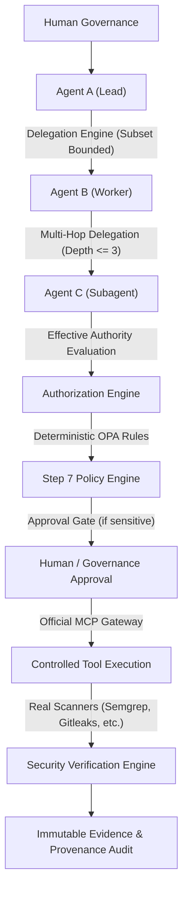

# System Architecture — Steps 1 to 11

## Overview
The SecureAI platform establishes an authoritative, deterministic security control plane for AI agents and developer workflows. Every decision, delegation, and execution is provably enforced by deterministic policy, cryptographic identities, and immutable database persistence in PostgreSQL.

## Security Boundary Progression
1. **Identity & Authentication (Step 10)**: Cryptographically verified agent credentials with SHA-256 key hashing (`agk_*`). No client-side identity assertions.
2. **Authority & Delegation (Step 11)**: Strict mathematical subset enforcement:
   $$\text{EffectiveAuthority}(B) \subseteq \text{DelegatedAuthority} \subseteq \text{Authority}(A)$$
   Authority can never increase through delegation.
3. **Data-Flow Governance (Step 11)**: Multi-tier data classifications (`PUBLIC`, `INTERNAL`, `CONFIDENTIAL`, `SENSITIVE`, `SECRET`, `RESTRICTED`). Automatic secret forwarding is prohibited.
4. **Step 7 Policy Engine**: Open Policy Agent / deterministic boolean algebra deciding `ALLOW`, `BLOCK`, `REQUIRE_APPROVAL`.
5. **Runtime Tool Execution (Step 9)**: Controlled MCP Gateway executing real CLI tools with sanitized arguments and captured stdout/stderr.
