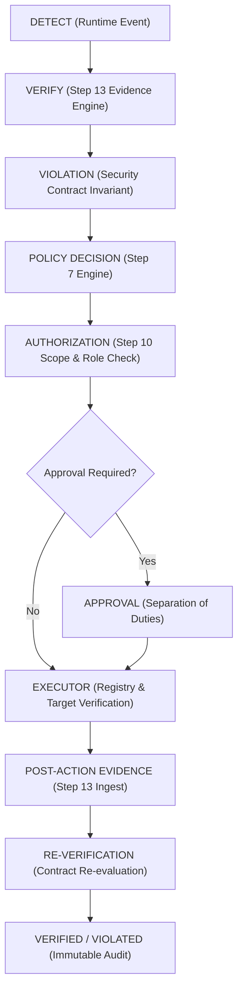

# Step 14: Runtime Security Agent & Controlled Enforcement

## 1. Architectural Golden Rule
> **"LLM proposes. Deterministic security systems decide. Runtime evidence proves."**

The Runtime Security Agent is **not** an unrestricted autonomous AI agent. It coordinates responses to verified runtime violations, but all security-critical decisions (what to block, isolate, revoke, or pause) are made strictly by deterministic policy (Step 7) and authorization (Step 10), executed by specialized modular executors, and proven by post-action evidence and contract re-verification (Step 13).



---

## 2. Response Action Model & Vocabulary
Structured vocabulary defined in `backend/app/response/enums.py`:
- `NO_ACTION`: Logged and monitored.
- `ALERT`: Alert recorded in database with target specifics.
- `NOTIFY`: Real notification if configured, otherwise recorded.
- `REQUIRE_APPROVAL`: Suspends execution pending independent human authorization.
- `BLOCK_REQUEST`: Terminates individual operation.
- `DENY_TOOL_CALL`: Creates short-lived active runtime enforcement rule blocking MCP tool execution.
- `REVOKE_SESSION`: Updates target session state to `REVOKED`.
- `REVOKE_DELEGATION`: Transitions Step 11 delegation to `REVOKED`.
- `SUSPEND_AGENT`: Marks agent as `SUSPENDED` in Step 10 registry.
- `ISOLATE_WORKLOAD`: Applies network/workload isolation.
- `QUARANTINE_ARTIFACT`: Quarantines compromised artifact.
- `PAUSE_DEPLOYMENT`: CI/CD deployment paused via integration API.
- `BLOCK_DEPLOYMENT`: CI/CD deployment blocked.
- `RESTRICT_DATA_FLOW`: Modifies Step 11 data-flow governance rules.

*Destructive actions (`DELETE_DATABASE`, `DELETE_CLUSTER`) are strictly forbidden from the response schema.*

---

## 3. Response State Machine
Deterministic state transitions enforced by `RuntimeResponseService`:
```
REQUESTED
   │
   ├─► PENDING_APPROVAL ──► APPROVED ──► AUTHORIZED ──► QUEUED ──► EXECUTING ──► COMPLETED
   │         │                 │
   │         └─► REJECTED      └─► CANCELLED
   │
   ├─► DENIED (Authorization failure)
   ├─► EXPIRED (Stale action)
   ├─► FAILED (Executor failure)
   └─► NOT_EXECUTED (Target/Config unavailable)
```

---

## 4. Separation of Duties & Self-Approval Prevention
- If an action requires approval, the requester (`requested_by_id`) **cannot** approve their own action:
  ```python
  if str(action.requested_by_id) == str(approver_id):
      return {"success": False, "error": "SELF_APPROVAL_FORBIDDEN"}
  ```
- The Runtime Security Agent cannot self-approve its own high-risk actions.

---

## 5. Active Runtime Enforcement Rules
Short-lived response rules stored in `runtime_enforcement_rules`:
- Fields: `project_id`, `rule_type`, `target_type`, `target_id`, `action`, `expires_at`, `status`.
- Integrated directly into Step 9 MCP Gateway (`backend/app/mcp/gateway.py`):
  If an active rule exists for the tool, the invocation is rejected immediately with status `DENIED` and `error_code="RUNTIME_ENFORCEMENT_BLOCKED"`.

---

## 6. Real Modular Executors
Managed by `ResponseExecutorRegistry`:
1. `AlertExecutor`: Real database record creation.
2. `MCPBlockExecutor`: Creates temporary `runtime_enforcement_rules`.
3. `SessionRevocationExecutor`: Sets `MCPSession.status = REVOKED`.
4. `DelegationRevocationExecutor`: Sets `AgentDelegation.status = REVOKED`.
5. `AgentSuspensionExecutor`: Updates `Agent.status = SUSPENDED`.
6. `DataFlowRestrictionExecutor`: Updates project data-flow governance.
7. `ContainerIsolationExecutor`: Interfaces with real Docker runtime (reports `EXECUTOR_NOT_CONFIGURED` if unconfigured).
8. `KubernetesIsolationExecutor`: Interfaces with real Kubernetes API (reports `EXECUTOR_NOT_CONFIGURED` if unconfigured).
9. `GitHubResponseExecutor`: Real GitHub Checks/Status API (reports `EXECUTOR_NOT_CONFIGURED` if token/repo absent).
10. `JenkinsPipelineExecutor`: Real Jenkins build control (reports `EXECUTOR_NOT_CONFIGURED` if server unreachable).

---

## 7. Reverification Loop
After an action reaches `COMPLETED`:
1. The execution result is packaged into a Step 13 runtime evidence event (`RESPONSE_EXECUTION`).
2. The Reverification Engine re-evaluates the original contract violation.
3. If the target threat is remediated, the contract verification status transitions to `VERIFIED` and the violation is marked `RESOLVED`. If not, it remains `VIOLATED`.

---

## 8. Known Limitations & Future Roadmap
- Step 14 handles **controlled enforcement** with deterministic policies and explicit human governance gates.
- **Step 15 (AI Investigation + Intelligent Remediation)** is intentionally separated and will add AI root-cause analysis without granting autonomous execution authority.
